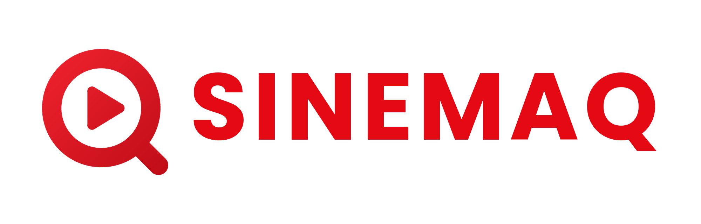

<div align="center">

  

  <p>
    A free, open-source media app for your phone, your desktop, and the TV you already own.
    <br />
    Bring your own sources. SINEMAQ turns them into a library with artwork, ratings, subtitles, and your place saved on every screen.
  </p>

  [GitHub releases](https://github.com/Callmerev95/SINEMAQ/releases/latest)

</div>

## Build from source

```bash
git clone https://github.com/Callmerev95/SINEMAQ.git
cd SINEMAQ
git submodule update --init
```

### Configuration

```bash
cp local.properties.example local.properties
```

Then fill in your own keys in `local.properties`. Keys left empty cleanly disable the related integration (Supabase, Sentry, TMDB, Trakt, Simkl, MDBList, Premiumize, IntroDB, IMDb ratings, release signing). The file is gitignored, so real keys are never committed.

### Android

Android development requires Android Studio and the Android SDK.

```bash
./gradlew :androidApp:assembleFullDebug
```

### iOS

iOS development requires macOS and Xcode.

```bash
env NUVIO_IOS_DISTRIBUTION=full xcodebuild \
  -project iosApp/iosApp.xcodeproj \
  -scheme iosApp \
  -configuration Debug \
  -sdk iphonesimulator \
  -derivedDataPath build/ios-derived-full-simulator \
  CODE_SIGNING_ALLOWED=NO \
  build
```

The shared app is built with Kotlin Multiplatform and Compose Multiplatform.

## Attribution

SINEMAQ is based on [NuvioMobile](https://github.com/NuvioMedia/NuvioMobile) by NuvioMedia, licensed under the [GNU General Public License v3.0](./LICENSE). All upstream attribution is preserved.

## License

[GNU General Public License v3.0](./LICENSE)
